# Tagih Tuntas

<p align="center">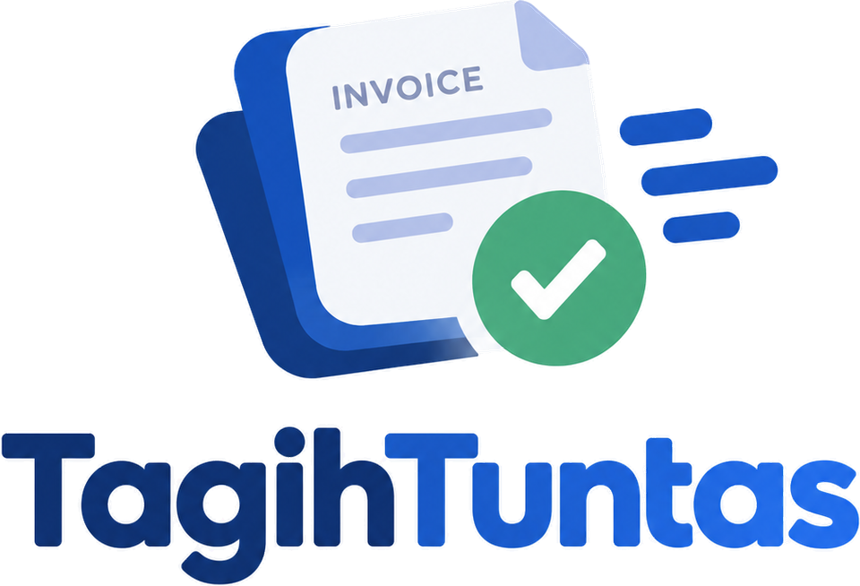</p>

MVP lokal untuk mengelola hambatan piutang B2B Indonesia: memeriksa kelengkapan dokumen sebelum invoice dikirim, memetakan penyebab keterlambatan, dan mengarahkan tindak lanjut ke pihak yang tepat. Dibangun dengan Next.js (App Router), TypeScript, dan penyimpanan JSON lokal.

Tidak memegang dana, tidak memberi pembiayaan, tidak mengirim pesan otomatis, dan tidak terintegrasi dengan bank, akuntansi, atau e-Faktur. Semua data seed fiktif.

## Tampilan

| | |
| --- | --- |
| **Dasbor piutang**: di mana invoice tersangkut dan siapa penanggung jawabnya.<br>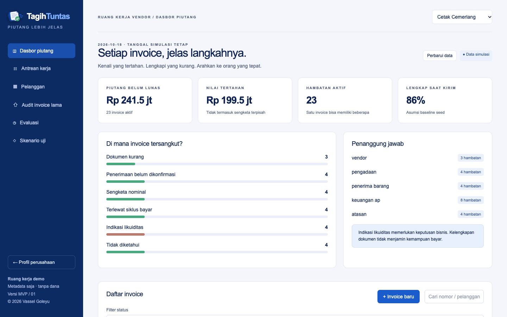 | **Antrean kerja**: hambatan diurutkan berdasarkan nilai, umur, dan peluang selesai.<br>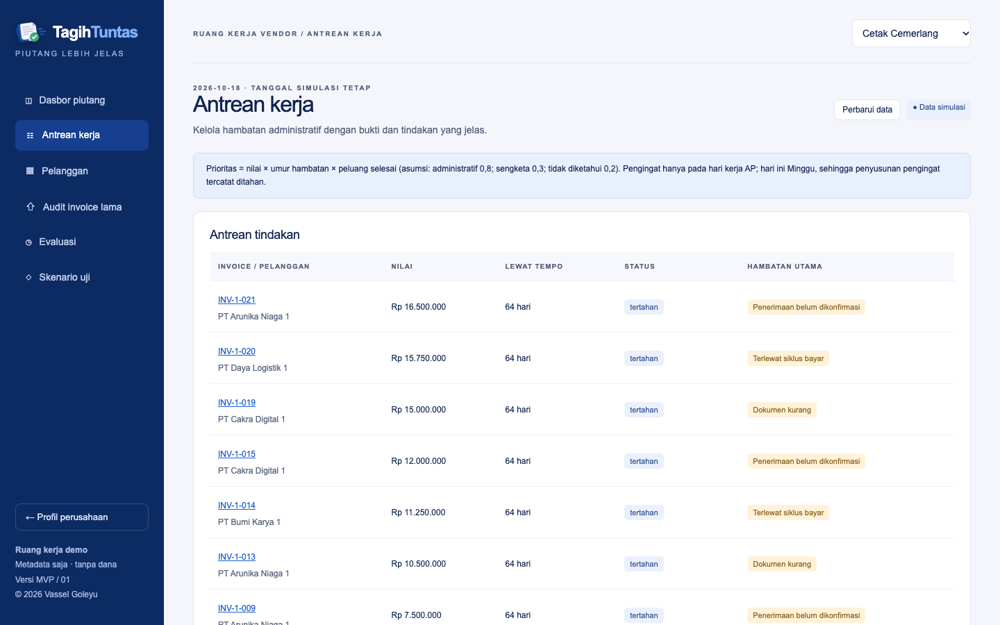 |
| **Detail invoice**: dokumen dicocokkan dengan syarat pelanggan.<br>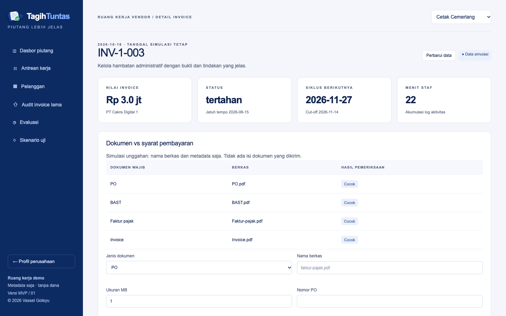 | **Gerbang pengiriman**: invoice ditolak kirim sampai dokumen cocok.<br>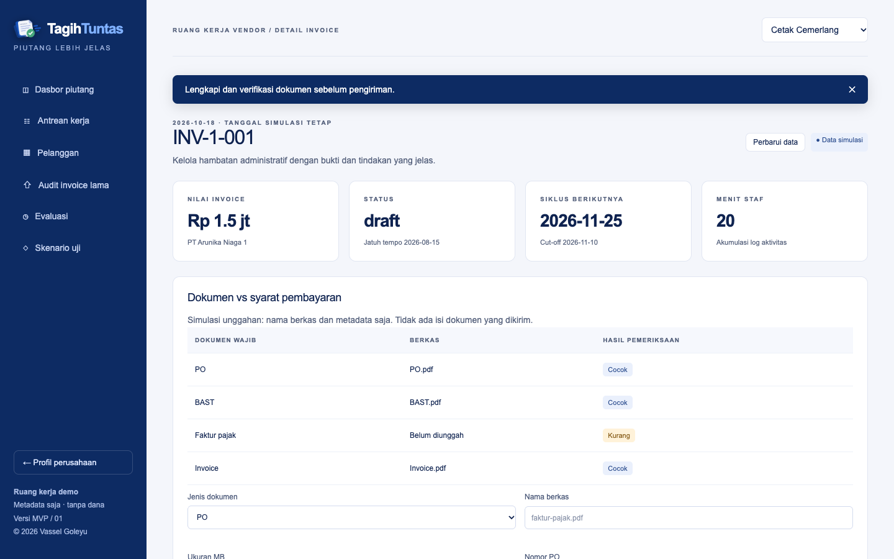 |
| **Profil syarat bayar**: termin, cut-off, dan tanggal bayar menentukan estimasi siklus.<br>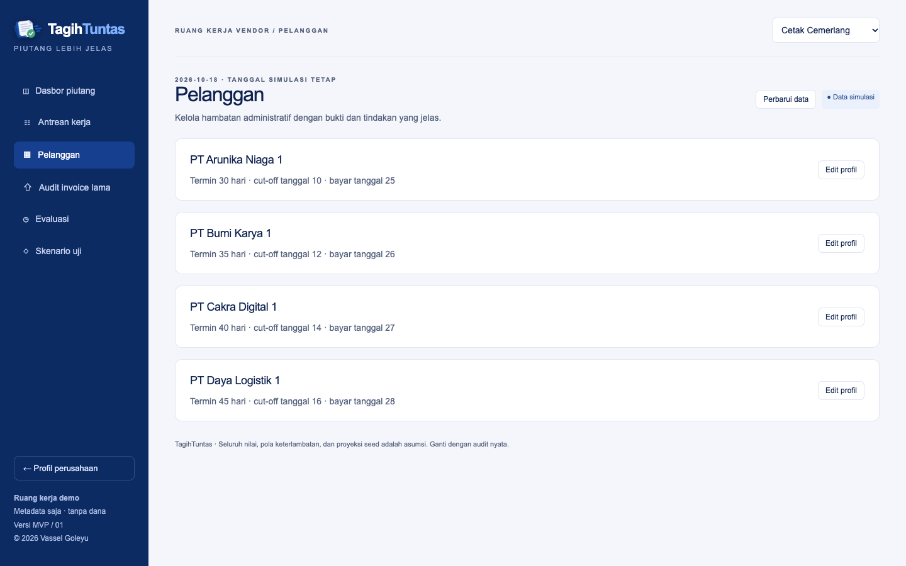 | **Audit invoice lama**: impor CSV historis dan lihat penyebab keterlambatan.<br>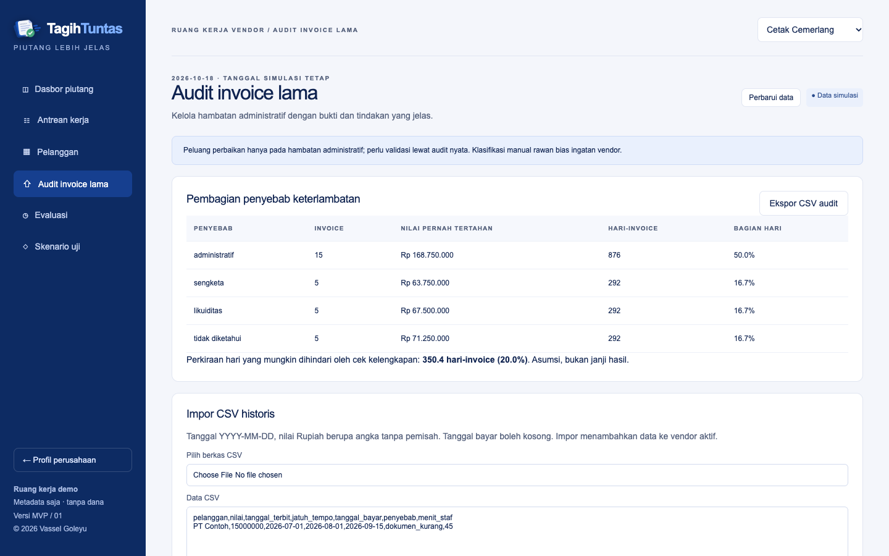 |
| **Evaluasi**: bandingkan proses sekarang dengan cek kelengkapan dan perutean.<br>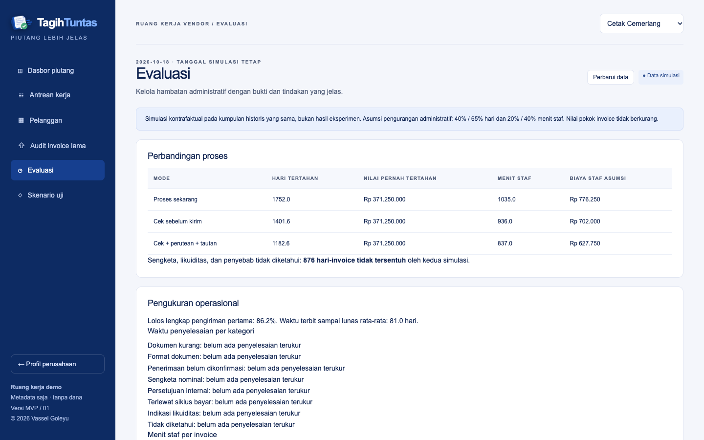 | **Profil perusahaan** (`/`): halaman perkenalan.<br>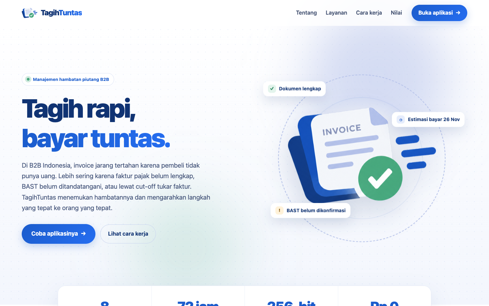 |

**Tampilan pembeli** (`/beli/[token]`) dan **ponsel**:

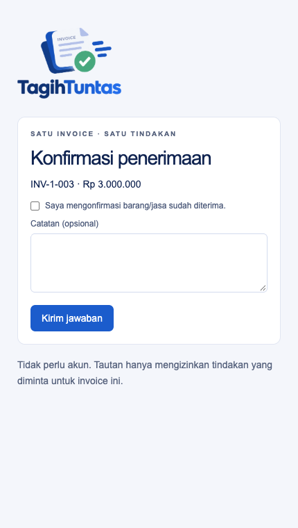 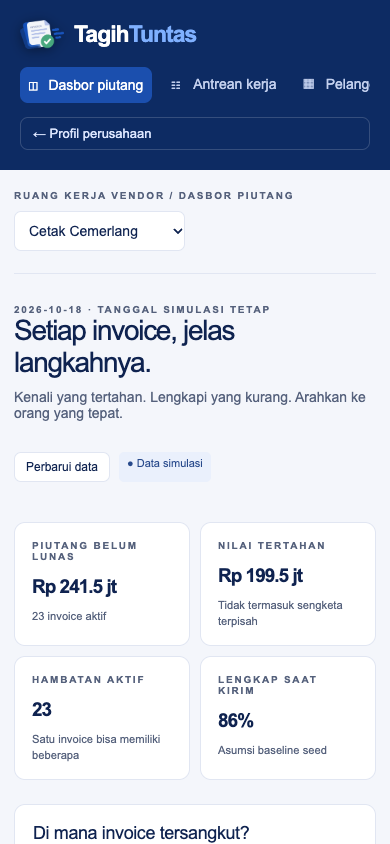

## Menjalankan

Prasyarat: Node.js 22.12+ dan npm.

```sh
npm install && npm start
```

Buka http://127.0.0.1:3000 (profil perusahaan) atau http://127.0.0.1:3000/aplikasi (aplikasi). Server terikat loopback. Data dibuat otomatis di `data/db.json` (diabaikan Git). Menu **Skenario uji → Reset seluruh data demo** mengembalikan data awal.

Variabel lingkungan opsional: `TAGIH_DATA_FILE` mengganti lokasi berkas data. Tidak ada variabel rahasia.

| Perintah | Fungsi |
| --- | --- |
| `npm test` | Tes inti dan integrasi penyimpanan (Vitest) |
| `npm run typecheck` | Pemeriksaan TypeScript |
| `npm run build` / `npm run serve` | Build produksi / jalankan hasil build |
| `npm run test:e2e` | Tes browser (Playwright); jalankan setelah build, perlu Google Chrome |
| `npm run format` / `format:check` | Prettier |

## Struktur

- `src/core`: logika murni tanpa UI/database: `model`, `config` (semua parameter asumsi), `seed`, `engine` (kelengkapan, siklus, diagnosis, status, audit, evaluasi), `csv`, `validation`.
- `src/server`: `store` (JSON lokal, mutasi, token pembeli) dan `http` (guard permintaan).
- `src/app`: `/` profil perusahaan, `/aplikasi` aplikasi vendor, `/beli/[token]` tampilan pembeli, `api/data` dan `api/buyer`.
- `tests`, `e2e`: tes unit/integrasi dan tes browser. `examples/audit.csv`: contoh impor.
- `docs/audit`: laporan audit, model ancaman, dan keputusan. Ringkasan temuan di [AUDIT.md](AUDIT.md).

## Aturan inti

1. **Kelengkapan**: dokumen dibandingkan dengan profil pelanggan (jenis wajib, ekstensi, ukuran, PO, cap/tanda tangan, verifikasi vendor, pola nomor invoice). Pengiriman ditolak sampai semuanya cocok.
2. **Siklus bayar**: dihitung dari hari tukar faktur, cut-off, tanggal payment run, hari kerja, dan jatuh tempo. Hari libur nasional, cut-off jam, dan beberapa payment run per bulan belum dimodelkan. Estimasi bukan janji pembeli.
3. **Diagnosis**: dokumen kurang/salah format, penerimaan belum dikonfirmasi, sengketa nominal, persetujuan belum ada, terlewat siklus, indikasi likuiditas (hanya bila semua administrasi lengkap dan riwayat lambat bayar ≥ 50%), atau **tidak diketahui**. Sinyal yang tidak cukup tidak ditebak.
4. **Status hambatan**: `terbuka → menunggu_pihak_lain → selesai | tidak_bisa_diselesaikan`. Penutupan butuh bukti; status terminal tidak diubah. Penjadwalan pembayaran ditolak selama ada hambatan yang belum selesai.
5. **Kadensi**: jeda 3 hari kerja AP, eskalasi setelah 7 hari. Teks pengingat hanya pratinjau; tidak ada pengiriman otomatis.
6. **Tautan pembeli**: satu invoice, satu aksi, sekali pakai, kedaluwarsa 72 jam, token acak 256-bit. Aksi ditentukan server dari token. Tautan dicabut saat lunas atau dibuat ulang, dan vendor dapat mencabutnya manual.
7. **Audit CSV**: header `pelanggan,nilai,tanggal_terbit,jatuh_tempo,tanggal_bayar,penyebab,menit_staf` (enam kolom pertama wajib, tanggal `YYYY-MM-DD`, nilai Rupiah tanpa pemisah). Impor bersifat semua-atau-tidak dan tidak melakukan deduplikasi.

Tanggal operasi demo tetap **2026-10-18** (`config.demoToday`), terpisah dari masa berlaku token.

## Skenario uji

Pilih vendor **Cetak Cemerlang**, lalu buka **Skenario uji** (S1–S8): dokumen kurang, lewat cut-off, penerimaan belum dikonfirmasi, sengketa nominal, indikasi likuiditas, tidak diketahui, token kedaluwarsa/salah, dan audit vendor dengan dominasi likuiditas (Seragam Prima, 81,7% hari-invoice). Tiap skenario memakai fixture terisolasi; tombol **Detail** membuka invoice untuk mutasi data nyata.

## Hasil validasi dan batas klaim

Pada data seed, administratif hanya 42% hari-invoice; sisanya sengketa, likuiditas, dan tidak diketahui. Simulasi evaluasi (pengurangan hari administratif 40%/65% dan menit staf 20%/40%) adalah asumsi sensitivitas, bukan prediksi atau bukti sebab-akibat, dan tidak menyentuh likuiditas atau sengketa. Keputusan: **GO untuk menguji prototipe, belum GO untuk klaim manfaat atau peluncuran komersial.** Parameter di `src/core/config.ts` perlu diganti dengan data audit nyata.

## Batasan

- **Tidak ada autentikasi.** Pemilih vendor hanya konteks kerja demo, bukan batas keamanan; API menolak host selain localhost. Jangan diekspos ke internet atau dipakai untuk data pelanggan nyata tanpa autentikasi, otorisasi per vendor, dan penyimpanan yang sesuai.
- JSON ditulis atomik untuk **satu proses**; tidak cocok untuk banyak instance atau hosting serverless (mis. Vercel). Halaman profil perusahaan saja yang dapat dideploy tanpa perubahan.
- Metadata dokumen diisi manual: tanpa OCR, tanda tangan digital, pembayaran, atau integrasi eksternal. Kontak hanya metadata kanal.
- Diuji di Chrome desktop dan viewport 390×844; Safari, Firefox, dan perangkat fisik belum diuji.

## Verifikasi

44 tes Vitest, 7 alur Playwright (build produksi, database temporer), TypeScript, dan Prettier lulus. Detail temuan dan keputusan: [docs/audit](docs/audit).
